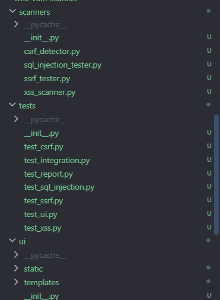
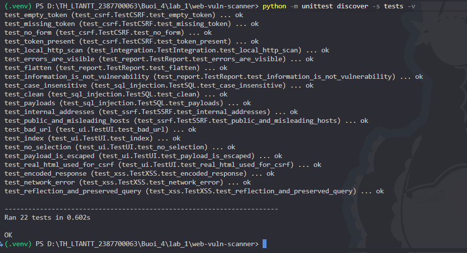
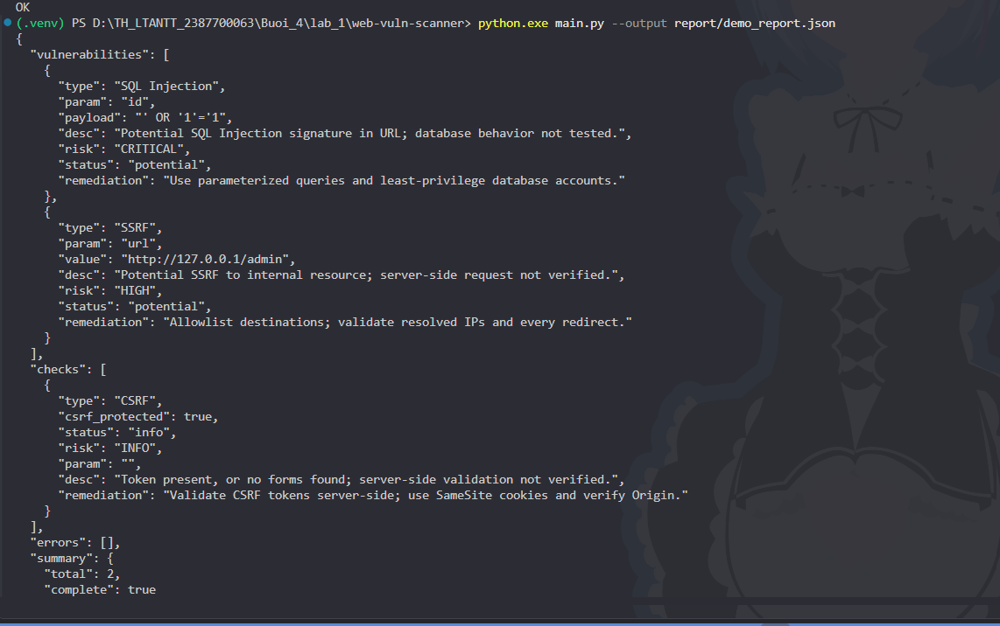
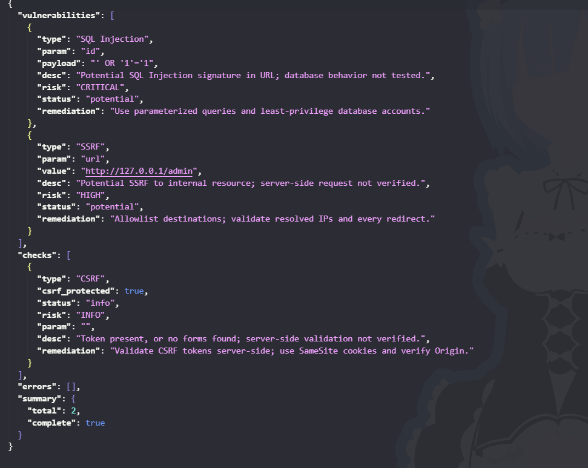
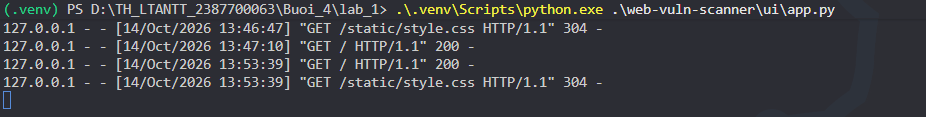
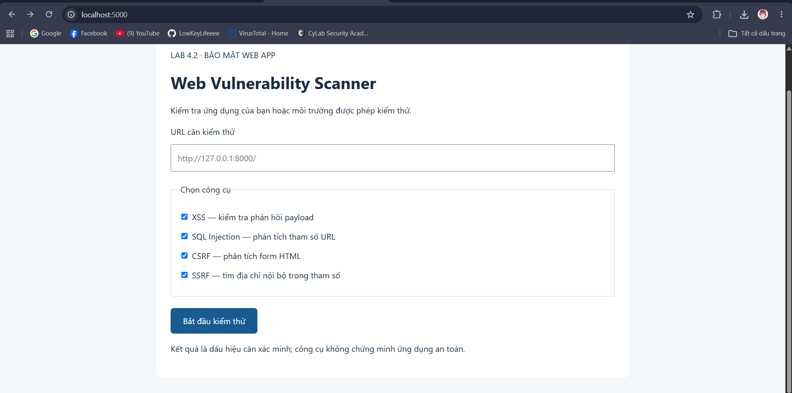
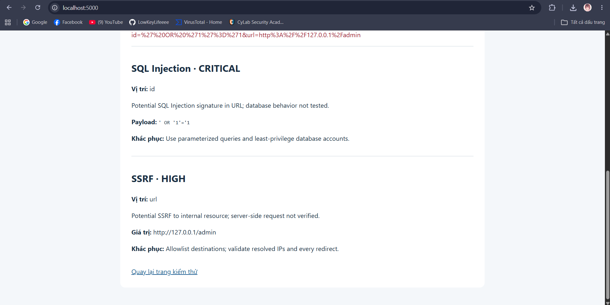
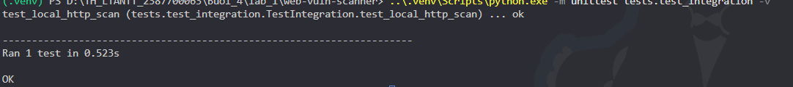

# Thực hành 4.2 WEBVULNSCANNER

Triển khai theo phần 4.2 của tài liệu lab-04.docx: bốn scanner, ReportGenerator,
chương trình dòng lệnh, giao diện Flask và unittest. Không bao gồm phần JWTSecure.

## Các công việc đã thực hiện

- Tạo thư mục `web-vuln-scanner` với các package `scanners`, `report`, `tests`,
  `ui`, các file `__init__.py`, `main.py` và `requirements.txt`.
- Viết `scanners/xss_scanner.py`: gửi hai payload XSS mẫu, kiểm tra phản chiếu
  trong phản hồi, giữ các tham số URL còn lại và ghi nhận lỗi HTTP/kết nối.
- Viết `scanners/sql_injection_tester.py`: nhận diện bốn chữ ký SQL Injection
  trong giá trị tham số URL, hỗ trợ URL encoding và so khớp không phân biệt hoa thường.
- Viết `scanners/csrf_detector.py`: phân tích từng form HTML, tìm token
  `csrf_token`, `_csrf`, `csrfmiddlewaretoken` có giá trị và báo form thiếu token.
- Viết `scanners/ssrf_tester.py`: tìm địa chỉ loopback, private, link-local và
  localhost trong tham số URL, bao gồm địa chỉ IPv6.
- Viết `report/report_generator.py`: tổng hợp phát hiện, trạng thái kiểm tra và
  lỗi; mỗi phát hiện có mô tả, mức độ rủi ro và gợi ý khắc phục.
- Viết `service.py`: kết nối bốn scanner, kiểm tra URL/nhóm công cụ đầu vào và
  tải HTML thật cho kiểm tra CSRF.
- Viết `main.py`: hỗ trợ demo offline, chọn scanner, nhập URL và xuất báo cáo JSON.
  Đã chạy demo và lưu kết quả tại `report/demo_report.json`.
- Viết giao diện Flask trong `ui/app.py`, hai template `index.html`,
  `result.html` và CSS: nhập URL, chọn công cụ, hiển thị kết quả và lỗi.
- Tạo môi trường `.venv` ở thư mục cha, cài Flask và requests.
- Viết và chạy **22 kiểm thử, tất cả thành công** ngày 14/10/2026, gồm scanner,
  báo cáo, giao diện qua Flask test client và quét HTTP server cục bộ.

Kết quả đã kiểm chứng: demo offline trả về **2 dấu hiệu** (SQL Injection và SSRF);
form có token CSRF được ghi vào `checks`, không tính là lỗ hổng. Kiểm thử tích hợp
trên server cục bộ trả về **3 dấu hiệu** (2 phản chiếu payload XSS và 1 form thiếu
token CSRF). Server này được test tự khởi động và dừng sau khi chạy.

Chưa thực hiện: xác minh khai thác trên website thực tế, thử SQLi trên nhiều DBMS,
kiểm chứng máy chủ thực hiện SSRF, commit/push Git và chụp ảnh minh chứng thủ công.
Các bước chụp bên dưới là hướng dẫn cần thực hiện, không phải ảnh đã có sẵn.

## Chạy trong thư mục bài lab hiện tại

Đã tạo môi trường `.venv` tại thư mục cha và cài Flask, requests.
Mở PowerShell tại `web-vuln-scanner`:

```powershell
..\.venv\Scripts\python.exe -m unittest discover -s tests -v
..\.venv\Scripts\python.exe main.py --output report/demo_report.json
..\.venv\Scripts\python.exe -m ui.app
```

Mở http://127.0.0.1:5000 để dùng giao diện. Ctrl+C để dừng máy chủ.
CLI không có `--url` chạy demo offline. Quét mục tiêu được phép:

```powershell
..\.venv\Scripts\python.exe main.py --url "http://127.0.0.1:8000/?q=hello" --output report/result.json
```

## Cài mới trên máy có Python 3.10 trở lên

```powershell
python -m venv .venv
.\.venv\Scripts\python.exe -m pip install -r requirements.txt
.\.venv\Scripts\python.exe -m unittest discover -s tests -v
.\.venv\Scripts\python.exe -m ui.app
```

## Chụp ảnh minh chứng

Các lệnh trong mục này chạy tại thư mục `web-vuln-scanner`, sử dụng môi trường
`.venv` đã tạo ở thư mục cha. Nếu cài mới theo mục trên, đổi
`..\.venv\Scripts\python.exe` thành `.\.venv\Scripts\python.exe`.

### 1. Cấu trúc mã nguồn

Chú thích: “Cấu trúc chương trình WebVulnScanner theo mục thực hành 4.2.”

### 2. Kết quả chạy kiểm thử



Chú thích: “22 kiểm thử thành công, gồm unit test và kiểm thử HTTP cục bộ.”

### 3. Chương trình chính và báo cáo JSON

```powershell
..\.venv\Scripts\python.exe main.py --output report/demo_report.json
```




Chú thích: “Demo offline phát hiện chữ ký SQL Injection và địa chỉ nội bộ có
nguy cơ SSRF; trạng thái có token CSRF được tách khỏi danh sách phát hiện.”

### 4. Khởi động và giao diện nhập liệu


[http://127.0.0.1:5000](http://127.0.0.1:5000),


Chú thích: “Giao diện Flask cho phép nhập URL và chọn công cụ kiểm thử.”

### 5. Kết quả phân tích SQLi và SSRF trên giao diện

Nhập URL mẫu sau vào form:

```text
http://example.com/page?id=%27%20OR%20%271%27%3D%271&url=http%3A%2F%2F127.0.0.1%2Fadmin
```



Chú thích: “Giao diện hiển thị dấu hiệu SQL Injection và SSRF từ URL mẫu;
kết quả chưa phải xác nhận khai thác thành công.”

### 6. Minh chứng kiểm thử XSS và CSRF qua HTTP cục bộ

```powershell
..\.venv\Scripts\python.exe -m unittest tests.test_integration -v
```



Chú thích: “Kiểm thử tích hợp XSS và CSRF trên HTTP server cục bộ thành công.”

## Cách hoạt động và giới hạn

- XSSScanner gửi hai payload theo mẫu đến từng tham số query (hoặc `q` nếu URL
  chưa có query). Phản chiếu payload chỉ là dấu hiệu, chưa chứng minh JavaScript
  thực thi. Không kiểm tra stored XSS hay DOM XSS.
- SQLInjectionTester nhận diện chữ ký SQL trong URL như mã mẫu, không gửi câu
  SQL đến máy chủ, không thực hiện khai thác hay xác minh trên nhiều DBMS.
- CSRFDetector đọc HTML thật, kiểm tra token riêng từng form. Có token không
  chứng minh máy chủ xác thực token; thiếu token có thể được bù bởi cơ chế khác.
- SSRFTester phân tích hostname/IP trong giá trị query; không truy cập các địa
  chỉ tìm được, không chứng minh máy chủ có thực hiện yêu cầu SSRF.
- ReportGenerator ghi mô tả, mức độ rủi ro giả định, hướng khắc phục và lỗi
  kết nối. Không coi trạng thái CSRF có token là lỗ hổng.

Các điểm điều chỉnh so với ảnh mã mẫu: dùng `__init__.py` đúng chuẩn Python,
bổ sung `requests`, mã hóa URL và giữ tham số cũ, không nuốt lỗi kết nối,
không dùng HTML giả trong UI, escape payload khi hiển thị và tắt debug.
Giao diện chỉ bind loopback để dùng trên máy cá nhân; không triển khai công khai.
Mỗi HTTP request có timeout 5 giây và không tự theo redirect.

Tests dùng mock và HTTP server loopback tự khởi động/dừng; không cần website bên ngoài.
Tài liệu có bước commit/push nhưng thư mục làm việc hiện tại không có repo Git;
bài này chỉ chuẩn bị mã nguồn và kiểm thử cục bộ.
