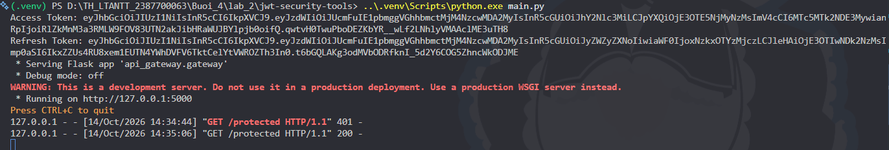
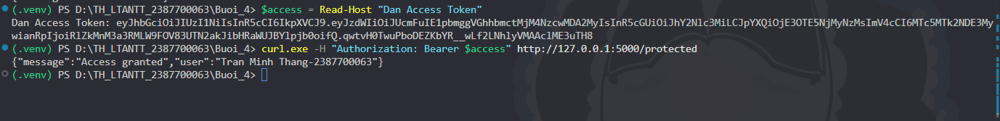

# Lab 04 JWTSECURE

Bộ công cụ theo yêu cầu thực hành trong tài liệu lab-04.docx, gồm đủ năm mô-đun và năm file kiểm thử. Python 3.10 trở lên.

## Chạy trong thư mục hiện tại

Môi trường `.venv` đã được cài tại thư mục cha. Mở PowerShell:

```powershell
cd D:\TH_LTANTT_2387700063\Buoi_4\lab_2\jwt-security-tools
..\.venv\Scripts\python.exe -m pytest -q --basetemp=.test-tmp
..\.venv\Scripts\python.exe smoke_test.py
..\.venv\Scripts\python.exe main.py
```

Nếu chuyển sang máy khác, tạo môi trường riêng:

```powershell
python -m venv .venv
.\.venv\Scripts\python.exe -m pip install -r requirements.txt
.\.venv\Scripts\python.exe -m pytest -q
.\.venv\Scripts\python.exe main.py
```

`main.py` in Access Token và Refresh Token để thực hành, sau đó phục vụ tại `http://127.0.0.1:5000`. Giữ terminal này mở. Khóa ký được sinh ngẫu nhiên mỗi lần chạy; có thể đặt biến môi trường `JWT_SECRET` với ít nhất 32 byte. Không có khóa thật được ghi cứng trong mã nguồn. Token in ra terminal là thông tin xác thực của phiên demo, không đưa lên Git.

## Kiểm tra bằng PowerShell

Mở terminal thứ hai, thay hai chuỗi bên dưới bằng token vừa in:

```powershell
$access = 'DAN_ACCESS_TOKEN_VAO_DAY'
$refresh = 'DAN_REFRESH_TOKEN_VAO_DAY'
curl.exe -H "Authorization: Bearer $access" http://127.0.0.1:5000/protected
curl.exe -i http://127.0.0.1:5000/protected

$body = @{ refresh_token = $refresh } | ConvertTo-Json
$pair = Invoke-RestMethod -Method Post -Uri http://127.0.0.1:5000/refresh -ContentType application/json -Body $body
$access = $pair.access_token
$refresh = $pair.refresh_token
curl.exe -H "Authorization: Bearer $access" http://127.0.0.1:5000/protected

$body = @{ refresh_token = $refresh } | ConvertTo-Json
Invoke-WebRequest -Method Post -Uri http://127.0.0.1:5000/revoke -ContentType application/json -Body $body
```

Token hợp lệ trả HTTP 200 và `{"message":"Access granted","user":"Tran Minh Thang-2387700063"}`. Thiếu token, sai chữ ký, hết hạn hoặc dùng refresh token để truy cập API đều trả 401. `/refresh` trả một cặp token mới và vô hiệu hóa refresh token cũ. `/revoke` trả 204; refresh token đã thu hồi không thể làm mới nữa. Access token đã phát hành còn hiệu lực đến khi hết hạn (mặc định 15 phút).

## Các mô-đun

- `jwt_validator/validator.py`: kiểm tra chữ ký, danh sách thuật toán cấu hình trước, bắt buộc `sub` và `exp`, kiểm tra thời gian, tùy chọn issuer/audience và loại token. Không chấp nhận `alg=none`; chỉ hỗ trợ HMAC để không trộn khóa RSA với HMAC.
- `jwt_cracker/cracker.py`: thử từng khóa trong file từ điển UTF-8 trên token của bài lab, hoàn toàn offline. Đọc file tuần tự để giới hạn bộ nhớ. Kiểm tra riêng chữ ký nên token hết hạn vẫn có thể dùng cho bài tập dò khóa.
- `oauth_client/client.py`: Authorization Code với `state` dùng một lần và PKCE S256, HTTPS cho endpoint, timeout và không theo redirect khi đổi code. `get_token(code, state)` cần state nhận từ callback. Mỗi đối tượng client cần gắn với một phiên người dùng; không dùng chung đối tượng cho nhiều phiên web.
- `token_manager/manager.py`: phát hành, làm mới, thu hồi và xoay vòng refresh token; `jti` ngẫu nhiên; khóa đồng bộ tránh đổi cùng một refresh token hai lần đồng thời.
- `api_gateway/gateway.py`: `/protected`, `/refresh`, `/revoke`; chỉ chạy trên loopback.

JWT được mã hóa biểu diễn bằng Base64URL, không phải mã hóa bảo mật nội dung. Không đặt mật khẩu hoặc dữ liệu nhạy cảm trong payload.

## Dùng OAuth client

```python
import os
from oauth_client.client import OAuthClient

client = OAuthClient(
    os.environ['OAUTH_CLIENT_ID'], os.environ.get('OAUTH_CLIENT_SECRET'),
    'https://provider.example/authorize', 'https://provider.example/token',
    'http://127.0.0.1:8080/callback',
)
print(client.get_auth_url())
# Sau khi nhận callback của nhà cung cấp, trên cùng đối tượng client:
# tokens = client.get_token(code_received, state_received)
```

Thay endpoint bằng thông tin nhà cung cấp và đăng ký redirect URI tương ứng. Bài lab kiểm thử HTTP OAuth bằng mock, chưa xác minh đăng nhập với nhà cung cấp thật. Đây là OAuth client lấy access token, chưa triển khai xác thực ID token của OpenID Connect.

## Khác biệt có chủ đích so với mã mẫu

Mã mẫu chưa có thu hồi token, thiếu kiểm tra state/PKCE và có khóa ký ghi cứng. Bản này bổ sung những phần đó, kiểm tra loại token ở gateway, xử lý token lỗi và dùng thời gian UTC dạng NumericDate. `refresh_access_token` được giữ cho bài tập gốc; phương thức này không tiêu thụ refresh token. API sử dụng `rotate_refresh_token` để thay token sau mỗi lần làm mới.

Danh sách refresh token hiện lưu trong RAM của một tiến trình; khởi động lại sẽ vô hiệu hóa toàn bộ refresh token cũ. Bản lab chưa có lưu trữ chia sẻ, thu hồi cả họ token khi phát hiện replay, đăng nhập người dùng, rate limiting hoặc máy chủ production. Chức năng rotation hiện từ chối dùng lại token cũ nhưng không thu hồi token con đã phát hành.

## Git và thông tin nhạy cảm

`.gitignore` ở thư mục cha loại trừ môi trường ảo, cache, file `.env`, token và ảnh trích xuất từ tài liệu. Không lưu khóa thật hay token đang sử dụng vào mã nguồn. Các khóa kiểm thử được sinh khi chạy; các chuỗi cố định trong test chỉ là dữ liệu thử.

Chỉ thực hiện commit/push khi đã xác định đúng repository và remote. Không tự đưa token vừa in hoặc toàn bộ thư mục môi trường ảo lên remote.

## Kết quả chạy thực tế ngày 14 tháng 10 năm 2026

Python 3.12: **45 kiểm thử thành công**. Hai cảnh báo độ dài khóa xuất hiện khi cracker cố ý thử khóa yếu; đây là tình huống của bài tập. Các phiên bản thư viện đã dùng được ghi trong `requirements-lock.txt`; có thể cài bằng `python -m pip install -r requirements-lock.txt` để tái lập môi trường.

Đã chạy `main.py` bằng tiến trình riêng và gửi HTTP thật qua `smoke_test.py`: access token hợp lệ trả 200; refresh token truy cập `/protected` trả 401; làm mới trả 200; dùng lại refresh token cũ trả 401; thu hồi trả 204; làm mới sau thu hồi trả 401. Script dừng tiến trình sau kiểm tra và không ghi token ra file.


## Tài liệu đối chiếu

- Tài liệu bài tập: `D:\lab-04.docx`.
- [PyJWT API](https://pyjwt.readthedocs.io/en/latest/api.html): cố định thuật toán và yêu cầu claim cần thiết.
- [RFC 9700](https://www.rfc-editor.org/rfc/rfc9700.html): PKCE và bảo vệ vòng đời refresh token.
