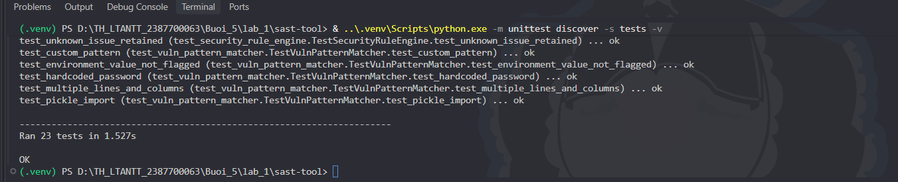
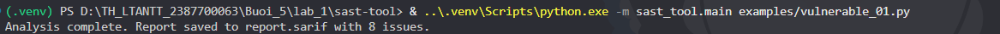
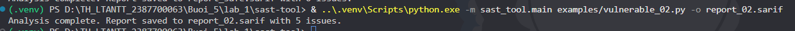
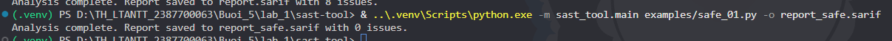

# Lab 1 — Phần 5.2 Thực hành SAST TOOL

Bài làm xây dựng công cụ phân tích tĩnh mã Python theo phần 5.2 của `D:\lab-05.docx`. Công cụ đọc mã nguồn, phát hiện các mẫu có rủi ro, kiểm tra chất lượng mã và xuất báo cáo SARIF 2.1.0. Không thực thi file được phân tích. Không bao gồm phần DAST.

## Cấu trúc bài làm

```text
lab_1/
├── .venv/                        Môi trường Python cục bộ, không đưa lên Git
└── sast-tool/
    ├── examples/
    │   ├── vulnerable_01.py       Ví dụ 1 trong đề
    │   ├── vulnerable_02.py       Ví dụ 2 trong đề
    │   └── safe_01.py             Ví dụ sau khi sửa
    ├── rules/default_rules.json  Các luật gán mức độ nghiêm trọng
    ├── sast_tool/
    │   ├── __init__.py
    │   ├── ast_analyzer.py
    │   ├── vuln_pattern_matcher.py
    │   ├── security_rule_engine.py
    │   ├── code_quality_checker.py
    │   ├── sarif_reporter.py
    │   └── main.py
    ├── tests/                    23 kiểm thử
    ├── requirements.txt
    ├── report.sarif              Kết quả ví dụ 1
    ├── report_02.sarif           Kết quả ví dụ 2
    └── report_safe.sarif         Kết quả ví dụ đã sửa
```

## Chạy trên máy hiện tại

Môi trường `.venv` đã được cài thư viện. Mở terminal PowerShell và chạy:

```powershell
cd D:\TH_LTANTT_2387700063\Buoi_5\lab_1\sast-tool
& ..\.venv\Scripts\python.exe -m unittest discover -s tests -v

& ..\.venv\Scripts\python.exe -m sast_tool.main examples/vulnerable_01.py

& ..\.venv\Scripts\python.exe -m sast_tool.main examples/vulnerable_02.py -o report_02.sarif

& ..\.venv\Scripts\python.exe -m sast_tool.main examples/safe_01.py -o report_safe.sarif

```

Các lệnh gọi trực tiếp Python trong môi trường ảo nên không cần chạy `Activate.ps1` hay thay đổi ExecutionPolicy. Không chạy trực tiếp hai file `vulnerable_*.py`; dùng chúng làm đầu vào cho công cụ.

Nếu chuyển sang máy mới, cài Python 3.10 trở lên, mở terminal tại `lab_1`, rồi tạo môi trường:

```powershell
python -m venv .venv
& .\.venv\Scripts\python.exe -m pip install -r .\sast-tool\requirements.txt
cd sast-tool
```

Ba thư viện trong đề được giữ lại và cố định phiên bản: Flake8 7.3.0, sarif-om 1.0.4, jsonpickle 4.1.1. Đã kiểm tra bằng Python 3.13.7 trên Windows.

## Các thành phần

**ASTAnalyzer** dùng `ast.parse()` và duyệt các lời gọi hàm để phát hiện `eval()` và `exec()`. Kết quả chứa loại vấn đề, thông điệp, dòng và cột. Chuỗi hay comment chứa chữ `eval` không bị nhận nhầm thành lời gọi hàm.

**VulnPatternMatcher** dùng biểu thức chính quy phát hiện mật khẩu ghi trực tiếp trong mã và import `pickle`. Có thể truyền danh sách mẫu tùy chỉnh qua `VulnPatternMatcher(patterns=[...])`; mỗi mẫu có hai trường `pattern` và `message`.

**SecurityRuleEngine** đọc JSON và gán `high`, `medium`, `low` cho từng loại vấn đề. Có thể thêm hoặc thay đổi luật trong `rules/default_rules.json`, hoặc chỉ định file khác bằng tùy chọn `--rules`. Loại vấn đề chưa có luật vẫn được giữ với mức mặc định `medium`. Bộ máy luật ánh xạ mức độ; muốn phát hiện loại lỗi mới cần thêm mẫu hoặc logic phân tích tương ứng.

**CodeQualityChecker** chạy Flake8 bằng cùng Python với công cụ. Phát hiện lỗi phong cách, import không sử dụng, tên chưa định nghĩa và độ phức tạp McCabe vượt 10 qua mã C901. Flake8 không phải bộ phát hiện lỗ hổng đầy đủ; kết quả lint là dấu hiệu chất lượng mã cần xem xét.

**SarifReporter** dùng mô hình `sarif-om` và metadata của nó để xuất đúng tên trường SARIF. Mức `high` ánh xạ sang `error`, `medium` sang `warning`, `low` sang `note`. Trường tùy chọn bằng giá trị mặc định có thể được bỏ qua; ví dụ SARIF mặc định `level` là `warning`. Báo cáo ghi URI tuyệt đối của file và vị trí dòng/cột bắt đầu từ 1. Khi chuyển thư mục hoặc máy, chạy lại để cập nhật URI.

Luồng xử lý: đọc file → phân tích AST và mẫu → chạy Flake8 → gán mức độ bằng luật → xuất SARIF.

## Kết quả đã kiểm tra

- Unit test: **23/23 đạt**. Bao gồm kiểm tra năm thành phần, tích hợp CLI, cột Unicode, đường dẫn chứa khoảng trắng, đầu vào sai cú pháp và bảo đảm không thực thi mã được quét.
- `vulnerable_01.py`: **8 vấn đề**, gồm 1 `eval`, 2 pattern (mật khẩu giả và `pickle`), 5 lỗi lint.
- `vulnerable_02.py`: **5 vấn đề**, gồm 1 `eval`, 1 `exec`, 3 lỗi lint.
- `safe_01.py`: **0 vấn đề** trong phạm vi các luật hiện có.
- Mã trong `sast_tool` và `tests` vượt qua `python -m flake8 --isolated sast_tool tests`.

Ví dụ 1 giữ mật khẩu giả `123456` để minh họa phát hiện hardcoded password, không phải thông tin đăng nhập thực. File đã sửa dùng biến môi trường `LAB_PASSWORD`, loại bỏ import `pickle` và thay `eval` bằng `ast.literal_eval`. Hàm `literal_eval` chỉ đọc literal; không thay thế chức năng tính biểu thức như `2 + 2` và vẫn cần giới hạn kích thước đầu vào khi dùng trong ứng dụng thực tế.

Kết quả 0 chỉ có nghĩa các luật hiện tại không phát hiện vấn đề, không chứng minh chương trình hoàn toàn an toàn.

## Các sửa đổi so với mã mẫu trong Word

1. Thêm phát hiện `exec()` vốn xuất hiện trong ví dụ thứ hai. Vì vậy ví dụ 2 có 5 kết quả thay vì 4 như ảnh trong đề.
2. Sửa cách xuất SARIF: serialize trực tiếp đối tượng bằng `jsonpickle` giữ `schema_uri`, `start_line`, `physical_location`; bản này chuyển theo metadata thành `$schema`, `startLine`, `physicalLocation` và bỏ trường tùy chọn chưa được đặt.
3. Sửa vị trí cột của regex: phải tìm dấu xuống dòng cuối cùng trước kết quả bằng `rfind`, không phải dấu đầu tiên bằng `find`.
4. Flake8 xuất riêng dòng, cột, mã và thông điệp, tránh tách nhầm dấu `:` trong đường dẫn ổ đĩa Windows. Chuẩn hóa cột Flake8 từ 1-based về 0-based trước khi xuất SARIF.
5. Dùng `sys.executable -m flake8`, đọc mã theo encoding khai báo của Python và tìm file luật theo vị trí module.
6. Gán severity cho cả lỗi lint; báo lỗi rõ ràng nếu thiếu Flake8 thay vì trả báo cáo rỗng.
7. Unit test thực sự kiểm tra phát hiện lỗi và nội dung SARIF; đóng file tạm trước khi chạy subprocess để tương thích Windows.

## Xem báo cáo trong VS Code

SARIF Viewer `MS-SarifVSCode.sarif-viewer` đã được cài trên máy. Mở folder `sast-tool` trong VS Code, sau đó mở `report.sarif`. Nếu chỉ thấy JSON, nhấn `Ctrl+Shift+P`, tìm lệnh của **SARIF** để mở log và chọn báo cáo. Chọn từng kết quả trong SARIF Results để đến dòng mã tương ứng.

Ảnh minh chứng nên tự chụp khi nộp bài: terminal chạy test thành công, lệnh quét mỗi ví dụ, kết quả trong SARIF Viewer và đối chiếu file đã sửa. Chưa tạo ảnh chụp giao diện hoặc xác nhận thao tác mở báo cáo trong VS Code.

## Giới hạn của công cụ

Công cụ minh họa ở mức bài lab. AST hiện chỉ nhận lời gọi trực tiếp `eval` và `exec`, chưa phân tích alias, shadowing, luồng dữ liệu hay liên hàm. Regex có thể khớp comment/chuỗi và bỏ sót một số cách viết import hoặc gán biến. Import `pickle` là cảnh báo cần rà soát, chưa chứng minh có giải tuần tự dữ liệu không tin cậy. Công cụ chưa bao phủ SQL injection, XSS, phân quyền hoặc mọi chỉ số chất lượng trong phần lý thuyết 5.1.

## Nộp bài bằng Git

Repository cha đang ở nhánh `main`. Chưa tạo commit hoặc push cho bài này. Kiểm tra diff và các file sẽ nộp trước khi chạy các lệnh sau từ thư mục gốc repository:

```powershell
cd D:\TH_LTANTT_2387700063
git status --short
git add -- Buoi_5/lab_1/.gitignore Buoi_5/lab_1/sast-tool
git diff --cached --stat
git diff --cached
git commit -m "[lab 5.2] implement Python SAST tool"
git push origin main
```

Repository có cấu hình hook `.githooks`. Nếu GitSecure chặn mật khẩu minh họa giống trong đề, đọc thông báo, bỏ giá trị gán cứng khỏi file được chỉ ra và dùng biến môi trường như `safe_01.py`, rồi chạy lại test/quét và kiểm tra diff trước khi commit. Kết quả báo cáo sẽ thay đổi sau khi thay mẫu. Không tắt hoặc bỏ qua hook. Không đưa mật khẩu thật hay `.venv` lên Git.

## Tài liệu đối chiếu

- Đề bài: `D:\lab-05.docx`, chỉ phần 5.2 Thực hành SAST TOOL.
- [Mô hình SARIF Python của Microsoft](https://github.com/microsoft/sarif-python-om).
- [Tùy chọn định dạng đầu ra và độ phức tạp của Flake8](https://flake8.pycqa.org/en/latest/user/options.html).
