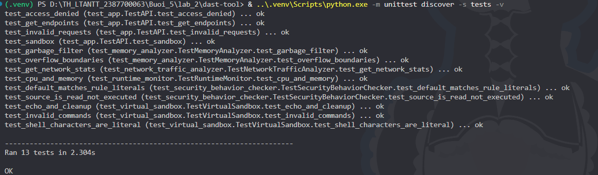
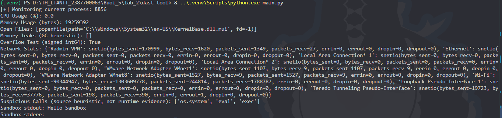
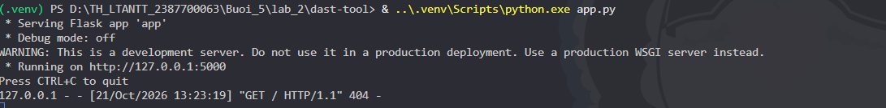
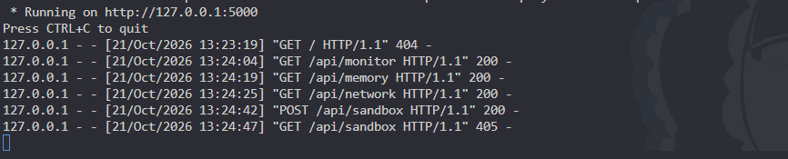

# Lab 2 — THỰC HÀNH DAST-TOOL

Bài làm theo phần DAST trong `D:\lab-05.docx`, gồm 5 lớp, chương trình console, Flask API và unit test. Chạy trên Python 3.13, Windows.

## Cấu trúc

```text
lab_2/
├── .venv/
└── dast-tool/
    ├── __init__.py
    ├── requirements.txt
    ├── memory_analyzer.py
    ├── network_traffic_analyzer.py
    ├── runtime_monitor.py
    ├── security_behavior_checker.py
    ├── virtual_sandbox.py
    ├── main.py
    ├── app.py
    └── tests/
```

## Chạy bài

Mở terminal PowerShell:

```powershell
cd D:\TH_LTANTT_2387700063\Buoi_5\lab_2\dast-tool
& ..\.venv\Scripts\python.exe -m unittest discover -s tests -v

& ..\.venv\Scripts\python.exe main.py

& ..\.venv\Scripts\python.exe app.py

```

Giữ terminal cuối đang chạy API, mở terminal thứ hai để thử từng endpoint:

```powershell
Invoke-RestMethod http://127.0.0.1:5000/api/monitor | ConvertTo-Json -Depth 5
Invoke-RestMethod http://127.0.0.1:5000/api/memory | ConvertTo-Json -Depth 5
Invoke-RestMethod http://127.0.0.1:5000/api/network | ConvertTo-Json -Depth 5
Invoke-RestMethod http://127.0.0.1:5000/api/security | ConvertTo-Json -Depth 5
Invoke-RestMethod http://127.0.0.1:5000/api/sandbox -Method Post -ContentType 'application/json' -Body '{"command":"echo Hello Sandbox"}' | ConvertTo-Json

```

Kết quả sandbox mong đợi: `stdout` là `Hello Sandbox` kèm xuống dòng; `stderr` rỗng. `/api/memory` trả `overflow_test: true` cho `2**64`. CPU, RSS, file mở và bộ đếm mạng phụ thuộc thời điểm chạy. `/api/monitor` đo chính tiến trình chạy Flask trong khoảng 1 giây. Nhấn Ctrl+C ở terminal API để dừng.

Trên máy mới, tạo môi trường từ thư mục `lab_2`:

```powershell
python -m venv .venv
& .\.venv\Scripts\python.exe -m pip install -r .\dast-tool\requirements.txt
```

Không cần kích hoạt môi trường hay thay đổi ExecutionPolicy.

## Ý nghĩa và giới hạn của mã mẫu

- `RuntimeMonitor`: lấy CPU, RSS theo byte và file mở của PID qua psutil. Không ghi lại toàn bộ lịch sử gọi hàm hay I/O. Trên Windows, danh sách file mở có thể không đầy đủ.
- `MemoryAnalyzer`: gọi GC và tìm đối tượng có finalizer trong `gc.garbage`. Danh sách rỗng không chứng minh chương trình không rò rỉ. `check_overflow` chỉ kiểm tra miền số nguyên có dấu 64-bit; Python có số nguyên độ chính xác tùy ý nên đây không phải phát hiện buffer overflow.
- `NetworkTrafficAnalyzer`: đọc bộ đếm tích lũy theo card mạng trên toàn máy, không bắt gói tin, phân loại C2 hay xác định lưu lượng của riêng PID.
- `SecurityBehaviorChecker`: giữ cách tìm chuỗi của bài mẫu. Mặc định đọc chính file chứa luật nên cả `os.system`, `eval`, `exec` đều khớp ngay trong định nghĩa luật. Kết quả này không chứng minh các hàm đã chạy. Có thể truyền `source_path` khi gọi lớp để thử file khác; không có endpoint đọc đường dẫn tùy ý.
- `VirtualSandbox`: chạy demo trong thư mục tạm, tự dọn sau khi dùng. Đây không phải môi trường cách ly hệ điều hành và không dùng để chạy mã không tin cậy.

## Các điều chỉnh so với ảnh code trong Word

1. Sửa biên int64: `2**63` bị vượt miền; `-2**63` vẫn hợp lệ. Loại bool khỏi kiểm tra số nguyên.
2. Giữ lệnh mẫu `echo test` và `echo Hello Sandbox`, nhưng chỉ hỗ trợ `echo <text>`. Dùng chương trình Python cố định và `shell=False`; dấu `&`, `|`, `>` trong thông điệp chỉ được in ra. Lệnh khác trả HTTP 400. Có timeout 5 giây, giới hạn chiều dài và dọn thư mục tạm.
3. Flask chỉ lắng nghe `127.0.0.1:5000`, tắt debug; kiểm tra JSON đầu vào và xử lý lỗi truy cập tiến trình.
4. Không nuốt lỗi đọc file của bộ kiểm tra chuỗi; bổ sung test biên, JSON lỗi, ký tự shell và dọn tài nguyên.

## Minh chứng nộp bài

Đã kiểm tra bằng Python 3.13.7, psutil 7.2.2 và Flask 3.1.3: 13/13 test đạt; `main.py` chạy thành công và in `Hello Sandbox`. Cả 5 endpoint đã được kiểm tra qua Flask test client. Chưa chạy một phiên HTTP server thường trực. Kiểm thử phải chạy ngoài sandbox của Codex do môi trường đó chặn truy vấn file mở của Windows và thao tác dọn thư mục tạm.

Chụp terminal unit test, kết quả `main.py`, terminal Flask và phản hồi 5 API. Mã nguồn có sẵn để đưa vào repository của bạn; bước commit/push trong tài liệu là hướng dẫn nộp bài, chưa được tự thực hiện.

## Tài liệu đối chiếu

- Đề bài: `D:\lab-05.docx`, phần THỰC HÀNH DAST-TOOL.
- [psutil — bộ đếm mạng và tiến trình](https://psutil.readthedocs.io/stable/index.html).
- [Python subprocess — shell và bảo mật](https://docs.python.org/3/library/subprocess.html#security-considerations).
- [Python tempfile — dọn thư mục tạm](https://docs.python.org/3/library/tempfile.html).
